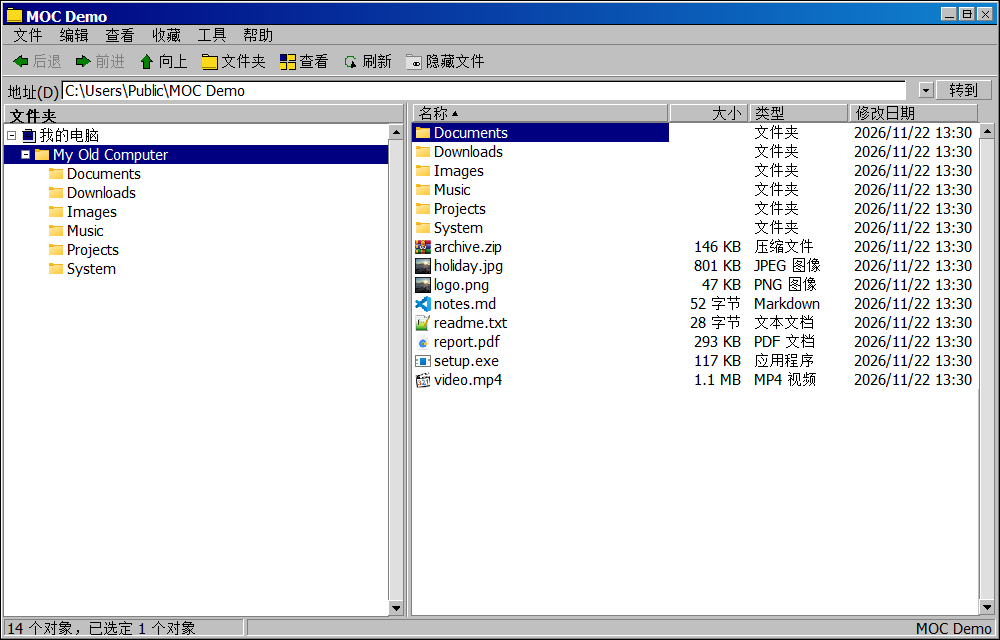

<p align="center"></p>

<h1 align="center">My Old Computer</h1>

<p align="center"><b>A Windows 98 file manager that actually works — on macOS and Windows.</b><br>
Native AppKit on one side, native Win32 on the other.<br>
Every pixel is drawn in code: no Electron, no theme pack, no bitmap assets.</p>

<p align="center">English · <a href="README.zh.md">中文</a></p>

<p align="center"><b><a href="https://github.com/menzi11/my-old-computer/releases/latest">Download the Windows build</a></b> · <a href="#build">Build from source</a></p>

<p align="center">


</p>



## What it is

My Old Computer is a standalone file manager that looks and behaves like Windows 98
Explorer: bevelled grey chrome, Tahoma, a folder tree on the left, details on the
right, and no rounded corners, shadows or animations anywhere.

It is not a theme for Finder or Explorer, and it does not replace the system shell.
It is a normal app you keep next to your other tools.

The title bar, menu bar, toolbar, address bar, status bar, scrollbars, splitter,
selection highlight and the hand-drawn icon set all come from code. On Windows the
file icons can instead come from the shell, so every type matches Explorer. The
repository has no bitmap UI assets — the only image is the generated app icon.

## Why this one

Most "Windows 98 file manager" projects are a modern file manager wearing a 98 skin:
an Electron shell, a runtime measured in tens of megabytes, and a themed title bar
around system dialogs. My Old Computer redraws the Explorer window itself on each
platform's own toolkit — AppKit on macOS, Win32 and GDI on Windows. The macOS build
is a ~700 KB `.app`; the Windows build is a single ~290 KB `.exe` with no runtime,
no installer and no third-party libraries to install.

Both builds follow one measured specification — [docs/ui-spec.md](docs/ui-spec.md) —
for palette, metrics, bevels and interaction rules. The two windows are not
"similar"; they are the same window compiled against two toolkits.

## Two builds, one design

| | macOS | Windows |
|---|---|---|
| Toolkit | AppKit | Win32 + GDI |
| Language | Swift 5 | C++17 |
| Binary | ~700 KB `.app` | ~290 KB `.exe` |
| Requirement | macOS 13+ | Windows 10 / 11 (x64) |
| Build | `./build.sh` | `.\windows\build.ps1` |
| Delete | Trash | Recycle Bin |
| Preview | Quick Look | Quick View (WIC) |
| Shell extras | Reveal in Finder, Terminal | Reveal in Explorer, `cmd.exe` |
| Roots | `/Volumes` | Drive letters |

## Features

**Navigation that survives a full day** — Back / Forward / Up with a real history
stack, an address bar that shows the way to the folder as buttons you click,
Explorer's breadcrumbs (Windows build), and takes a path you type, and a
keyboard shortcut for every action.

**Three working views** — details with Name / Size / Type / Date columns and
click-to-sort (directories first, natural name order), list and large-icon views.
Switching views keeps the selection. On the Windows build a folder that is mostly
pictures opens as thumbnails, each picture in place of its icon. Details rows have no full-row select: only
clicking the icon or the file name picks the row, so the Size / Type / Date
columns stay free for scrolling and rubber-band selection.

**Explorer's commands in a Windows 98 menu** — right-clicking a file or folder
asks the shell for its menu, then draws it with this app's own Win98 popup, so
7-Zip, Git, your editors, Send To, Previous Versions and every other installed
extension is there without the modern Windows look.  This app adds Quick View,
Open in new window (Ctrl and a click on a folder does it too), a colour for a
folder, Reveal in Explorer, Copy path, a terminal here and a
reliable Rename.  The tree opens the same menu for the folder under the pointer;
the empty area keeps working View / Sort / Refresh / New commands.  Tools →
Context menu settings lists every shell entry grouped by where the right-click
happened - empty area, folder, file, per file type - and each one can be hidden
in that context only; any extension can be added to the list by hand.
The menu is built ahead of the click, on a thread of its own: the shell and
its extensions take 70–300 ms to make one (half a second for the first in a
window), and the window used to stand still for all of it - now the menu is
up within 20 ms of the click.  Where its own menu was not built yet, a menu
of the same kind of file stands in for it and is made to say its own's say
when that one is in: the menu is put up once, with no flicker.  With the menu
open, one click anywhere else closes it and is that click: 查看 on the menu
bar opens at once, another file is selected.
**A sidebar that knows the machine** — My Computer with every drive or mounted
volume, folders that expand with `+` / `−`, a Favorites group at the top (a folder
joins it from its context menu or by being dropped on it; its favorites rename,
remove and reorder by dragging), a draggable splitter and a tree that reveals the
folder you are browsing.

**File operations, not just browsing** — new folder, rename, move to Trash or the
Recycle Bin, copy / cut / paste through the system clipboard, drag & drop between
folders and to or from other apps (Explorer, the desktop), rubber-band selection,
multi-select with Shift and Ctrl / Command.

**Preview without opening a second app** — `Space` opens Quick Look on macOS
(images and PDFs get real thumbnails) or a Quick View window on Windows (images
decoded with WIC, text files shown in place, anything else gets its properties).

**A headless renderer** — the whole window can render itself to a PNG without
being shown, which is how every screenshot in this README was produced.

### Practical extras

- Sort arrow in the active column, `字节 / KB / MB / GB` sizes and `yyyy/M/d HH:mm` dates
- Toolbar button and View-menu toggle for hidden and system files
- File and folder icons come from the shell on Windows, so every type matches Explorer;
  the View menu can switch back to the hand-drawn icon set
- Copy the selected paths to the clipboard
- Reveal in Finder / Explorer, open a terminal in the current folder
- Window frame, sidebar width, favorites and view mode persist between launches
- Demo mode (`--demo`) replaces the sidebar tree so screenshots do not leak real folder names
- No configuration files to edit; settings live in user defaults

## Screenshots

| | macOS | Windows |
|---|---|---|
| Details |  |  |
| Large icons |  |  |
| List |  |  |

All screenshots use the app's demo mode, so no real folder names appear.

**File type icons** are drawn per extension, at 16 px, with hard edges:


## Keyboard shortcuts

| Action | macOS | Windows |
|---|---|---|
| Open selection | `Return` | `Enter` |
| Go to parent folder | `Backspace`, `⌘↑` | `Backspace`, `Alt+↑` |
| Back / Forward | `⌘[` / `⌘]`, `Alt+←` / `Alt+→` | `Alt+←` / `Alt+→` |
| Details / List / Large icons | `⌘1` / `⌘2` / `⌘3` | `Ctrl+1` / `Ctrl+2` / `Ctrl+3` |
| Refresh | `⌘R`, `F5` | `F5` |
| Rename | `F2`, `⌘Return` | `F2` |
| Preview | `Space` | `Space` |
| Select all | `⌘A` | `Ctrl+A` |
| Cut / Copy / Paste | `⌘X` / `⌘C` / `⌘V` | `Ctrl+X` / `Ctrl+C` / `Ctrl+V` |
| Move to Trash / Recycle Bin | `⌘Delete`, `Fn+Delete` | `Delete` |

## Build

### macOS

Requirements: macOS 13 or newer and the Xcode Command Line Tools
(`xcode-select --install`). No Xcode, no package manager, no third-party libraries.

```bash
./build.sh
open "build/My Old Computer.app"
```

`build.sh` compiles every Swift file with `swiftc -O`, assembles the bundle,
generates `AppIcon.icns` when needed, and signs the app.

#### About code signing

`build.sh` signs with a local self-signed certificate named `Win98 Explorer Dev`
when one exists, otherwise with an ad-hoc signature. The certificate matters
because macOS keys folder-access permissions (Desktop, Documents, Downloads) to
the app's code requirement: an ad-hoc signature's requirement is the binary hash,
which changes on every rebuild and makes macOS ask for permission again. Create the
stable identity once with:

```bash
./scripts/make-signing-identity.sh
```

Without it the app still works; macOS simply asks again after every rebuild.

### Windows

The latest prebuilt executable is on the
[releases page](https://github.com/menzi11/my-old-computer/releases/latest); unzip is
not needed, it is a single `.exe`. To build it yourself:

Requirements: Windows 10 or 11, and the MSVC C++ tools — Visual Studio 2022
(Community or Build Tools) with the *Desktop development with C++* workload.
No CMake, no vcpkg, no runtime to install.

```powershell
cd windows
.\build.ps1
.\build\MyOldComputer.exe
```

`build.ps1` finds the Visual Studio toolchain with `vswhere`, compiles every file
in `windows/src` with `cl /O2`, embeds the icon and version resource, and links a
single executable. `-Debug` builds unoptimised, `-Clean` removes `build\` first.

## How it is made

```
Sources/                 macOS app (Swift, AppKit, no storyboards or nibs)
  main.swift             app delegate, CLI flags, snapshot pipeline
  Theme.swift            palette, metrics, Tahoma
  Icons.swift            code-drawn folder / file / device icons
  Chrome.swift           window, title bar, menu bar, toolbar, address bar,
                         status bar, splitter, custom scrollbars
  Views.swift            details / list table, rows and cells
  Grid.swift             large-icon view with Quick Look thumbnails
  Tree.swift             sidebar tree, favorites, volume roots
  ExplorerController.swift  navigation, selection, file operations, menus, preview

windows/src/             Windows app (C++17, Win32, GDI)
  main.cpp               window, input, menus wiring, CLI flags, self test
  render.cpp             the whole window, drawn into any HDC
  app.cpp                navigation, selection, tree, file operations, persistence
  fs.cpp                 listings, natural sort, recycle bin, shell helpers
  canvas.cpp             GDI primitives: fills, 1 px bevels, text
  icons.cpp              the same icon set, drawn on a 16 × 16 grid
  shellicons.cpp         icons from the Windows shell image lists
  menu.cpp               ownerdrawn Win98 popup menus
  dialog.cpp             ownerdrawn modal dialogs
  preview.cpp            Quick View window (WIC image decode, text, properties)
  scrollbar.cpp          scrollbar geometry shared by drawing and hit testing
  snapshot.cpp           DIB render + PNG encode through WIC
  theme.h                palette and metrics, mirroring Theme.swift

docs/ui-spec.md          the shared visual and behavioural contract
scripts/make_icon.swift  generates the 98-style .icns from pixel art
Resources/Info.plist
```

Everything is event driven and owner drawn: rows, cells and scrollbars implement
their own painting, the bevels are single-pixel rectangles, and the selection is
filled only behind the icon and the name.

## Headless verification

Both builds can render themselves to a PNG without a visible window, which is how
the screenshots above were produced.

macOS:

```bash
"build/My Old Computer.app/Contents/MacOS/MyOldComputer" \
  --snapshot /tmp/shot.png --path ~/Downloads --view details
```

Windows:

```powershell
.\windows\build\MyOldComputer.exe --snapshot shot.png --size 1000x640 `
  --path "$env:TEMP\demo" --view details --select 0 --demo
```

Useful debug flags: `--dump` (geometry and menu dump), `--selftest`
(file-operation self test), `--select 0,1`, `--view icons|list|details`,
`--scale 2` for a retina-sized render, and `--demo` for clean screenshots.

The Windows build's `--selftest` currently reports:

```
SELFTEST 列目录 OK | 大图标 OK | 排序 OK | 新建文件夹 OK |
         重命名 OK | 回收站 OK | 复制 OK | 同名副本 OK | 移动 OK | 拖放同目录 OK
```

## Limitations

- Neither build can become the system shell. Finder stays in charge of the macOS
  desktop; Explorer stays in charge of the Windows desktop, taskbar and file
  associations.
- macOS asks for permission the first time a protected folder (Desktop, Documents,
  Downloads) is opened. Approve once and it is remembered as long as the app keeps
  the same signing identity (see above).
- Delete moves items to the real macOS Trash (labelled 回收站 in the UI). macOS
  protects `~/.Trash` with Full Disk Access, so a third-party app can put files in
  it but cannot list or empty it — that is why there is no Trash entry in the
  sidebar; use Finder to browse or empty it.
- On Windows the large-icon view draws the hand-drawn type icon; the macOS build
  additionally shows Quick Look thumbnails for images and PDFs.
- Ejecting mounted disk images is a macOS-only extra.
- The Windows executable is not code-signed. SmartScreen may ask for confirmation
  on first launch.
- The custom frame means the Windows Snap Layouts flyout (the one that appears when
  hovering the maximize button) does not apply. Dragging and resizing work
  normally.
- No tabs and no file search yet. One window, one folder.

## License

MIT — see [LICENSE](LICENSE).
