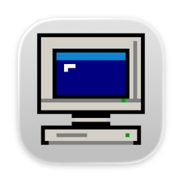
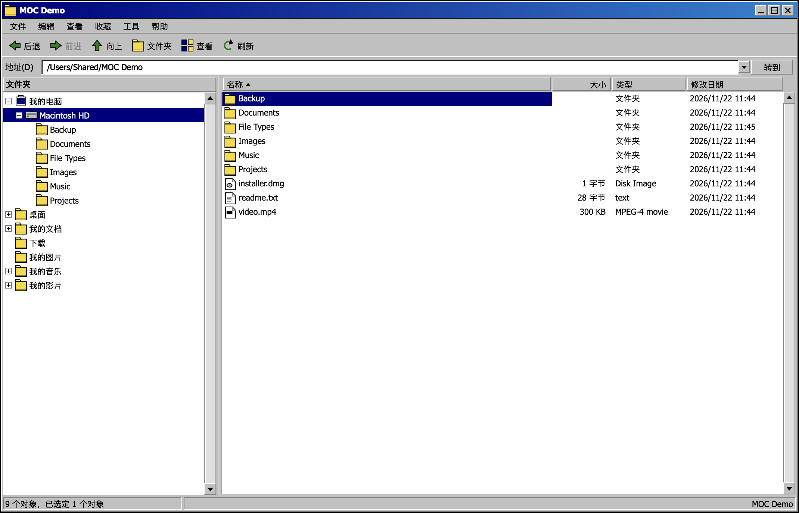
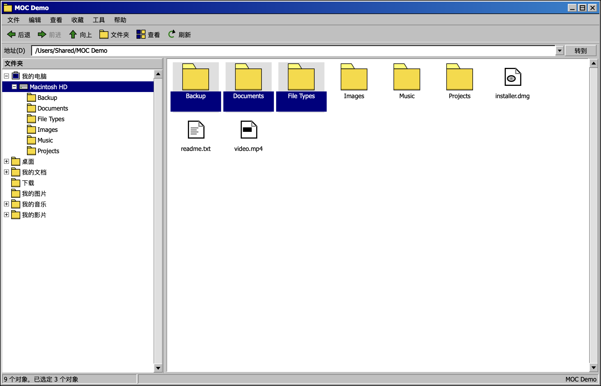
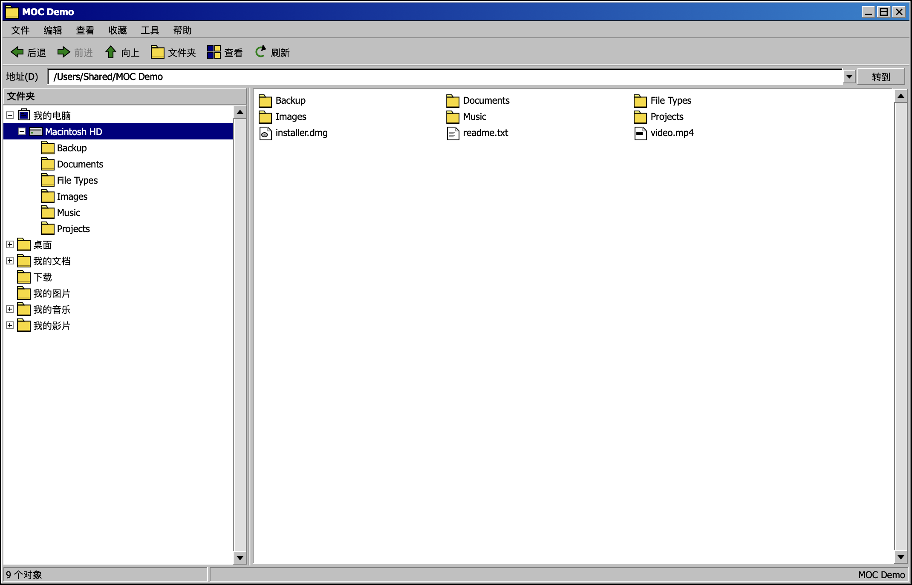
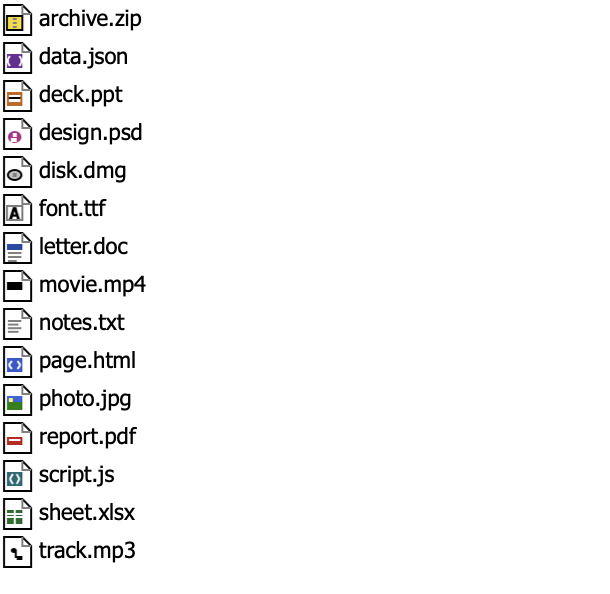

<p align="center"></p>

<h1 align="center">My Old Computer</h1>

<p align="center">A pixel-faithful Windows 98 file manager for macOS.<br>
Native AppKit, zero dependencies, ~700 KB, no Xcode required.</p>

<p align="center">


</p>



## What is this?

A real, working file manager that looks and behaves like the Windows 98 Explorer:
bevelled grey chrome, Tahoma, a folder tree on the left, details on the right,
and no rounded corners, shadows or animations anywhere.

It is not a theme for Finder, and it does not replace Finder as the system shell
(macOS does not allow that). It is a standalone `.app` you can keep next to your
other tools.

Every pixel is drawn in code: the title bar, menu bar, toolbar, address bar,
status bar, scrollbars, splitter, selection highlight and the entire icon set.
There is not a single bitmap asset in the repository except the generated app icon.

## Features

**Window chrome**
- Custom borderless window: 1 px hard bevels, no translucency, no shadows, no animation
- Win98 palette (`#C0C0C0` face, `#DFDFDF` highlight, `#808080` shadow, navy selection)
- Tahoma 11 throughout, custom scrollbars and splitter

**Navigation**
- Back / Forward / Up, address bar with `~` abbreviation, click-to-select-all
- Full keyboard shortcut set (see below), history stack

**Views**
- Details view with Name / Size / Type / Date columns and click-to-sort
- List view and Large Icons view
- Thumbnails from Quick Look for images and PDFs, otherwise hand-drawn 16 px file icons
- Marquee (rubber-band) selection; a row is only selected when the rubber band or the
  click actually covers the icon or the file name

**File operations**
- New folder, rename, move to Trash (回收站)
- Copy / Cut / Paste, drag & drop move and copy
- Multi-select with Shift and Command
- Right-click menus everywhere (list, icon view, sidebar tree)

**Sidebar**
- My Computer → volumes → folders, expandable with `+` / `-`
- 收藏夹 (Favorites) as a group of folders, seeded with Desktop and Downloads
- Draggable splitter between the tree and the file list
- Mounted disk images can be ejected from the context menu

**Extras**
- Quick Look preview with the space bar
- "Open in Terminal" and "Reveal in Finder" from the context menu
- Window frame, sidebar width, favorites and tree state persist between launches

## Screenshots

| Large icons | List |
|---|---|
|  |  |

All screenshots are taken with the app's demo mode, so no real folder names appear.

**File type icons** are drawn per extension, at 16 px, with hard edges:



## Keyboard shortcuts

| Keys | Action |
|---|---|
| `Return` | Open selected item |
| `Backspace` | Go to parent folder |
| `Cmd` + `↑` | Go to parent folder |
| `Cmd` + `[` / `Cmd` + `]` | Back / Forward |
| `Alt` + `←` / `Alt` + `→` | Back / Forward |
| `Cmd` + `1` / `2` / `3` | Details / List / Large Icons |
| `Cmd` + `R` or `F5` | Refresh |
| `F2` or `Cmd` + `Return` | Rename |
| `Space` | Quick Look preview |
| `Cmd` + `A` | Select all |
| `Cmd` + `C` / `X` / `V` | Copy / Cut / Paste |
| `Fn` + `Delete` or `Cmd` + `Delete` | Move to Trash (回收站) |

## Build

Requirements: macOS 13 or newer, and the Xcode Command Line Tools (`xcode-select --install`).
No Xcode, no package manager, no third-party libraries.

```bash
./build.sh
open "build/My Old Computer.app"
```

`build.sh` compiles all Swift files with `swiftc -O`, assembles the bundle, generates
`AppIcon.icns` if needed, and signs the app.

### About code signing

`build.sh` signs with a local self-signed certificate named `Win98 Explorer Dev` when
one exists, otherwise with an ad-hoc signature. The certificate matters because macOS
keys folder-access permissions (Desktop, Documents, Downloads) to the app's code
requirement: an ad-hoc signature's requirement is the binary hash, which changes on
every rebuild and makes macOS ask for permission again. To create the stable identity
once:

```bash
./scripts/make-signing-identity.sh
```

Without it, the app still works; macOS simply asks again after every rebuild.

## How it is made

```
Sources/
  main.swift              app delegate, CLI flags, snapshot pipeline
  Theme.swift             palette, metrics, Tahoma
  Icons.swift             code-drawn folder / file / device icons
  Chrome.swift            window, title bar, menu bar, toolbar, address bar,
                          status bar, splitter, custom scrollbars
  Views.swift             details/list view, table rows and cells
  Grid.swift              large-icon view with Quick Look thumbnails
  Tree.swift              sidebar tree, favorites, volume roots
  ExplorerController.swift  navigation, selection, file operations, menus, Quick Look
Resources/Info.plist
scripts/make_icon.swift   generates the 98-style .icns from pixel art
scripts/make-signing-identity.sh
```

Everything is one event-driven AppKit app with no storyboards and no nib files.
Rows, cells and scrollbars implement `draw(_:)` directly; the bevels are single-pixel
rectangles, and the selection is filled only behind the icon and the name.

### Headless verification

The app can render itself to a PNG without a window server, which is how the
screenshots in this README were produced:

```bash
"build/My Old Computer.app/Contents/MacOS/MyOldComputer" \
  --snapshot /tmp/shot.png --path ~/Downloads --view details
```

Useful debug flags: `--dump` (geometry and menu dump), `--selftest` (file-operation
self test), `--select 0,1`, `--view icons|list|details`, and `--demo` (replace the
sidebar tree with the current folder, for clean screenshots).

## Limitations

- It cannot become the macOS system shell; Finder stays in charge of the desktop.
- In a non-sandboxed app, macOS asks for permission the first time a protected folder
  (Desktop, Documents, Downloads) is opened. Approve once and it is remembered — as
  long as the app keeps the same signing identity (see above).
- Windows-only conveniences that need OS support (drive letters, `C:\` paths, `.lnk`
  shortcuts) are not emulated.
- Delete moves items to the real macOS Trash (shown as 回收站 in the UI). macOS
  protects `~/.Trash` with Full Disk Access, so a third-party app can put files in it
  but cannot list or empty it — that is why there is no Trash entry in the sidebar;
  use Finder to browse or empty it.

## 中文简介

用一个真正能用的文件管理器，复刻 Windows 98 资源管理器的样子：灰色立体边框、Tahoma 字体、
左侧文件夹树、右侧详细列表，全部界面元素和图标都是用代码画的，没有一张位图素材。

支持前进/后退/向上、地址栏、三种视图（详细/列表/大图标）、缩略图预览、空格 Quick Look、
剪切复制粘贴、拖放、框选、右键菜单、收藏夹、挂载镜像弹出、终端打开等。快捷键见上表。

编译只需要命令行工具：`./build.sh`，然后打开 `build/My Old Computer.app`。

## License

MIT — see [LICENSE](LICENSE).
