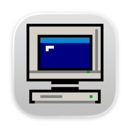
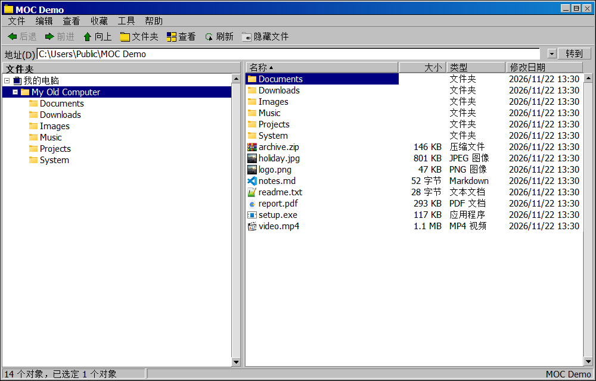
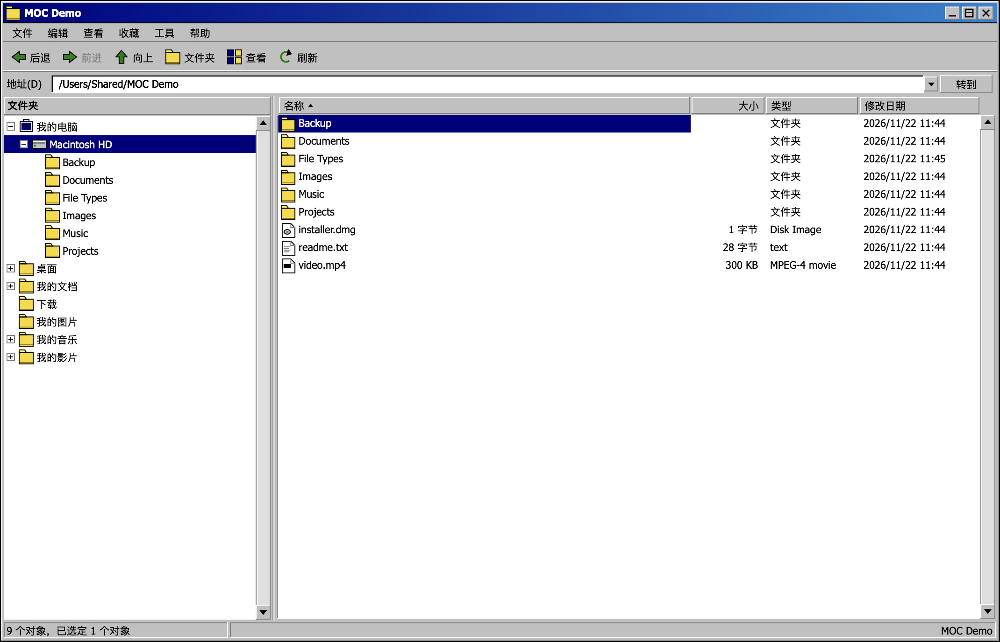
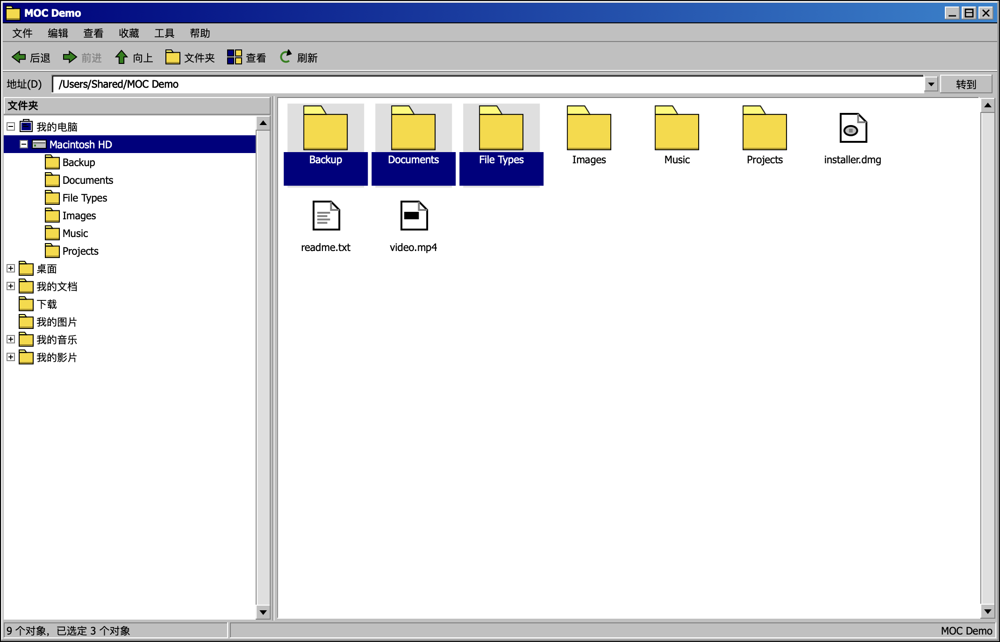
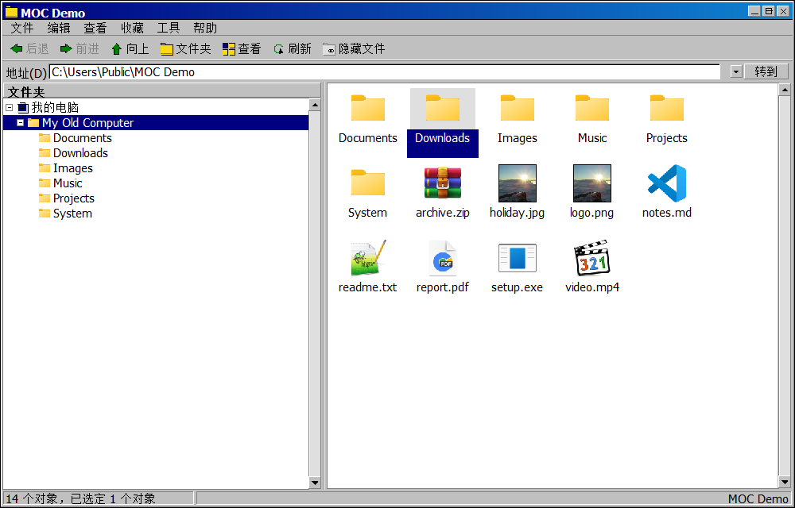
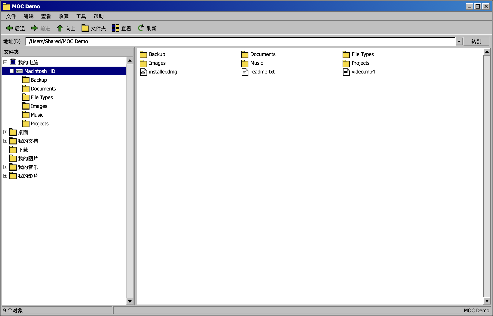
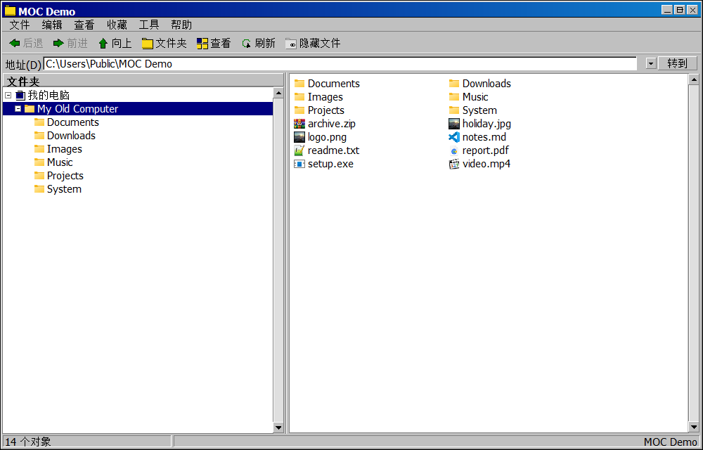
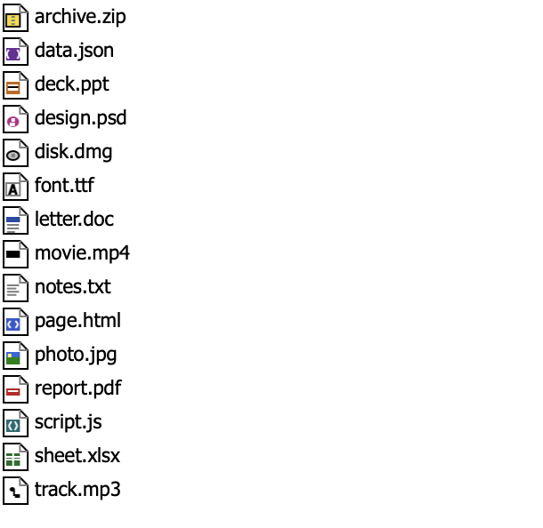

<p align="center"></p>

<h1 align="center">My Old Computer</h1>

<p align="center"><b>一个真正能用的 Windows 98 文件管理器，macOS 和 Windows 都有。</b><br>
一边是原生 AppKit，另一边是原生 Win32。<br>
所有界面元素都用代码画：没有 Electron，没有主题包，没有位图素材。</p>

<p align="center"><a href="README.md">English</a> · 中文</p>

<p align="center"><b><a href="https://github.com/menzi11/my-old-computer/releases/latest">下载 Windows 版</a></b> · <a href="#编译">从源码编译</a></p>

<p align="center">


</p>



## 这是什么

My Old Computer 是一个独立的文件管理器，外观和行为都照着 Windows 98 资源管理器来：
灰色立体边框、Tahoma 字体、左侧文件夹树、右侧详细列表，没有圆角、阴影和动画。

它不是 Finder 或资源管理器的主题，也不替换系统外壳，只是一个可以和其他工具并排放在
桌面上的普通应用。

标题栏、菜单栏、工具栏、地址栏、状态栏、滚动条、分隔条、选中高亮和手绘图标全部由
代码绘制；Windows 版也可以直接取系统 shell 的图标，让每种文件类型都和资源管理器一致。
仓库里没有任何位图界面素材，唯一的图片是生成出来的应用图标。

## 为什么选它

大多数「Windows 98 文件管理器」是给现代文件管理器套一层 98 皮肤的产物：Electron 外壳、
几十兆的运行时，再加一条主题标题栏，弹出来的还是系统对话框。My Old Computer 直接在
各平台自己的工具链上重画整个资源管理器窗口——macOS 用 AppKit，Windows 用 Win32 和 GDI。
macOS 版是约 700 KB 的 `.app`，Windows 版是单个约 290 KB 的 `.exe`，不需要运行时，
不需要安装程序，也没有任何第三方库。

两个版本遵循同一份量化规格 [docs/ui-spec.md](docs/ui-spec.md)：配色、尺寸、立体边和交互
规则都在里面。两个窗口不是「长得像」，而是同一个窗口分别用两套工具链编译出来的结果。

## 两个构建，一套设计

| | macOS | Windows |
|---|---|---|
| 工具链 | AppKit | Win32 + GDI |
| 语言 | Swift 5 | C++17 |
| 产物 | 约 700 KB 的 `.app` | 约 290 KB 的单个 `.exe` |
| 系统要求 | macOS 13+ | Windows 10 / 11（x64） |
| 编译 | `./build.sh` | `.\windows\build.ps1` |
| 删除 | 废纸篓 | 回收站 |
| 预览 | Quick Look | 快速查看（WIC） |
| 系统集成 | 在 Finder 中显示、终端 | 在资源管理器中显示、cmd |
| 根目录 | `/Volumes` | 盘符 |

## 功能

**能撑一整天使用的导航**——前进 / 后退 / 向上带完整历史；地址栏和资源管理器一样，
把通往当前文件夹的每一级显示成可以点的按钮（Windows 版），也可以直接输入路径跳转；
每个操作都有快捷键。

**三种视图都能干活**——详细信息视图带名称 / 大小 / 类型 / 修改日期四列，点列头排序
（文件夹优先、名称按自然顺序比较）；另有列表和大图标视图。切换视图会保留选中项。
Windows 版里，图片过半的文件夹打开就是缩略图，每张图代替它的图标。
详细信息视图没有「整行选中」：只有点图标或文件名才会选中，大小 / 类型 / 修改日期
那几列不会误选，方便滚动和框选。

**资源管理器的命令，Windows 98 的菜单**——在文件或文件夹上右键时，菜单条目向 shell 索取
（7-Zip、Git、你装的编辑器、发送到、还原以前的版本……所有已安装扩展都在），但由本程序自己
用 Win98 风格绘制，不再弹 Windows 现在那种菜单。上面还叠加了本程序自己的命令（快速查看、
在新窗口中打开——按住 Ctrl 单击文件夹也是、文件夹颜色、在资源管理器中显示、复制路径、
在此处打开命令提示符、可用的重命名）。
左侧树对文件夹弹出同一份菜单；空白处保留可用的查看 / 排序 / 刷新 / 新建。
工具 → 右键菜单设置 按**右键发生的场景**分组列出 shell 菜单条目——空白处、文件夹、文件、
按文件类型（.txt、.png……）——每个条目只在该场景下隐藏，互不影响；任意扩展名都可以手动添加进列表。
菜单在右键之前就在后台建好了：shell 和各个扩展建一份菜单要 70–300 毫秒（窗口里的第一份要半秒），
以前每一下右键都要干等，窗口也被堵住；现在 20 毫秒内弹出（它自己的菜单还没建的，先用同类型文件的菜单顶上，
等它自己的建好再就地改成它自己的——菜单只弹一次，不闪）。

**认识这台机器的侧栏**——「我的电脑」列出每个磁盘或挂载卷，文件夹用 `+` / `−` 展开，
收藏夹是侧栏最上面的一组常用目录（空的时候也在）：在文件夹的右键菜单里“添加到收藏夹”，
把文件夹拖到“收藏夹”上也可以；收藏项的右键菜单可以移除、重命名，在组里上下拖动排序。
分隔条可以拖动，浏览时树会自动展开并选中当前目录。

**除了浏览，还能改文件**——新建文件夹、重命名、移到废纸篓 / 回收站、通过系统剪贴板
剪切复制粘贴、在文件夹之间以及和其他应用（资源管理器、桌面）互相拖放、框选、
Shift / Ctrl（macOS 上是 Command）多选。

**不用另开应用就能预览**——空格键在 macOS 上打开 Quick Look（图片和 PDF 有真实缩略图），
在 Windows 上打开「快速查看」窗口（图片用 WIC 解码，文本直接显示，其他文件显示属性）。

**无窗口渲染**——整个窗口可以渲染成 PNG 而不显示出来，本 README 里的截图都是这么来的。

### 一些顺手的小功能

- 当前排序列上显示箭头，大小按 `字节 / KB / MB / GB` 显示，日期用 `yyyy/M/d HH:mm`
- 工具栏按钮和「查看」菜单都能切换显示隐藏文件和系统文件
- Windows 上的文件和文件夹图标取自系统 shell，各类文件与资源管理器完全一致；
  「查看」菜单可以切回手绘图标
- 把选中项的完整路径复制到剪贴板
- 在 Finder / 资源管理器中显示，或在当前目录打开终端 / 命令提示符
- 窗口位置尺寸、侧栏宽度、收藏夹和视图模式在两次启动之间保留
- 演示模式（`--demo`）会用演示目录替换侧栏树，截图不会带出真实文件夹名
- 没有需要手写的配置文件，设置保存在用户配置里

## 截图

| | macOS | Windows |
|---|---|---|
| 详细信息 |  |  |
| 大图标 |  |  |
| 列表 |  |  |

所有截图都在演示模式下拍摄，不会出现真实的文件夹名。

**文件类型图标**按扩展名绘制，16 px，硬边缘：



## 快捷键

| 操作 | macOS | Windows |
|---|---|---|
| 打开选中项 | `Return` | `Enter` |
| 返回上一级 | `Backspace`、`⌘↑` | `Backspace`、`Alt+↑` |
| 后退 / 前进 | `⌘[` / `⌘]`、`Alt+←` / `Alt+→` | `Alt+←` / `Alt+→` |
| 详细信息 / 列表 / 大图标 | `⌘1` / `⌘2` / `⌘3` | `Ctrl+1` / `Ctrl+2` / `Ctrl+3` |
| 刷新 | `⌘R`、`F5` | `F5` |
| 重命名 | `F2`、`⌘Return` | `F2` |
| 预览 | `Space` | `Space` |
| 全选 | `⌘A` | `Ctrl+A` |
| 剪切 / 复制 / 粘贴 | `⌘X` / `⌘C` / `⌘V` | `Ctrl+X` / `Ctrl+C` / `Ctrl+V` |
| 移到废纸篓 / 回收站 | `⌘Delete`、`Fn+Delete` | `Delete` |

## 编译

### macOS

需要 macOS 13 或更新版本，以及 Xcode 命令行工具（`xcode-select --install`）。
不需要 Xcode，不需要包管理器，不需要第三方库。

```bash
./build.sh
open "build/My Old Computer.app"
```

`build.sh` 用 `swiftc -O` 编译所有 Swift 文件、组装 app 包、按需生成 `AppIcon.icns`
并给应用签名。

#### 关于代码签名

`build.sh` 会优先用名为 `Win98 Explorer Dev` 的本地自签名证书签名，没有就用 ad-hoc
签名。证书之所以重要，是因为 macOS 把文件夹访问权限（桌面、文稿、下载）绑定到应用的
代码要求上：ad-hoc 签名的要求是二进制哈希，每次重新编译都会变，macOS 就会重新询问权限。
一次性创建稳定身份：

```bash
./scripts/make-signing-identity.sh
```

没有证书也能用，只是每次重新编译后 macOS 会再问一次。

### Windows

最新的可执行文件在
[Releases 页面](https://github.com/menzi11/my-old-computer/releases/latest)，单个 `.exe`，
不需要解压。自己编译：

需要 Windows 10 或 11，以及 MSVC C++ 工具——安装了「使用 C++ 的桌面开发」工作负载的
Visual Studio 2022（Community 或 Build Tools 都行）。不需要 CMake，不需要 vcpkg，
不需要安装运行时。

```powershell
cd windows
.\build.ps1
.\build\MyOldComputer.exe
```

`build.ps1` 用 `vswhere` 找到 Visual Studio 工具链，把 `windows/src` 下的源文件用
`cl /O2` 编译，嵌入图标和版本资源，链接成单个可执行文件。`-Debug` 编译不优化版本，
`-Clean` 先删掉 `build\`。

## 代码结构

```
Sources/                 macOS 应用（Swift、AppKit，没有 storyboard 和 nib）
  main.swift             应用委托、命令行参数、截图管线
  Theme.swift            配色、尺寸、Tahoma
  Icons.swift            代码绘制的文件夹 / 文件 / 设备图标
  Chrome.swift           窗口、标题栏、菜单栏、工具栏、地址栏、状态栏、分隔条、滚动条
  Views.swift            详细信息 / 列表表格、行和单元格
  Grid.swift             大图标视图与 Quick Look 缩略图
  Tree.swift             侧栏树、收藏夹、卷根节点
  ExplorerController.swift  导航、选择、文件操作、菜单、预览

windows/src/             Windows 应用（C++17、Win32、GDI）
  main.cpp               窗口、输入、菜单接线、命令行参数、自检
  render.cpp             整个窗口，可画到任意 HDC
  app.cpp                导航、选择、树、文件操作、设置持久化
  fs.cpp                 目录读取、自然排序、回收站、shell 辅助
  canvas.cpp             GDI 基础绘制：填充、1 px 立体边、文字
  icons.cpp              同一套图标，画在 16 × 16 网格上
  menu.cpp               自绘的 Win98 弹出菜单
  dialog.cpp             自绘的模态对话框
  preview.cpp            快速查看窗口（WIC 解码图片、文本、属性）
  scrollbar.cpp          绘制与命中测试共用的滚动条几何
  snapshot.cpp           DIB 渲染 + WIC 编码 PNG
  theme.h                与 Theme.swift 对应的配色和尺寸

docs/ui-spec.md          两个版本共享的视觉与行为规格
scripts/make_icon.swift  从像素画生成 98 风格的 .icns
Resources/Info.plist
```

整个程序都是事件驱动、自绘的：行、单元格和滚动条自己实现绘制，立体边是单像素矩形，
选中底色只铺在图标和名字后面。

## 无窗口验证

两个版本都能在窗口不显示的情况下把界面渲染成 PNG，上面的截图就是这么生成的。

macOS：

```bash
"build/My Old Computer.app/Contents/MacOS/MyOldComputer" \
  --snapshot /tmp/shot.png --path ~/Downloads --view details
```

Windows：

```powershell
.\windows\build\MyOldComputer.exe --snapshot shot.png --size 1000x640 `
  --path "$env:TEMP\demo" --view details --select 0 --demo
```

常用的调试参数：`--dump`（几何与菜单信息）、`--selftest`（文件操作自检）、
`--select 0,1`、`--view icons|list|details`、`--scale 2`（按 2 倍尺寸渲染）、
`--demo`（干净截图）。

Windows 版 `--selftest` 当前输出：

```
SELFTEST 列目录 OK | 大图标 OK | 排序 OK | 新建文件夹 OK |
         重命名 OK | 回收站 OK | 复制 OK | 同名副本 OK | 移动 OK | 拖放同目录 OK
```

## 限制

- 两个版本都不能成为系统外壳。macOS 的桌面仍由 Finder 负责；Windows 的桌面、任务栏和
  文件关联仍由资源管理器负责。
- macOS 第一次打开受保护目录（桌面、文稿、下载）时会请求权限。允许一次即可记住，前提是
  应用保持同一个签名身份（见上文）。
- Windows 版的大图标视图绘制的是按类型手绘的图标；macOS 版还会为图片和 PDF 显示
  Quick Look 缩略图。
- 弹出已挂载的磁盘映像是 macOS 独有的功能。
- Windows 可执行文件没有代码签名，首次运行时 SmartScreen 可能要求确认。
- 窗口使用自绘边框，因此 Windows 的贴靠布局浮层（悬停在最大化按钮上出现的那个）不适用；
  拖动和缩放本身正常。
- 目前没有标签页和文件搜索。一个窗口，一个目录。

## 许可证

MIT，见 [LICENSE](LICENSE)。
